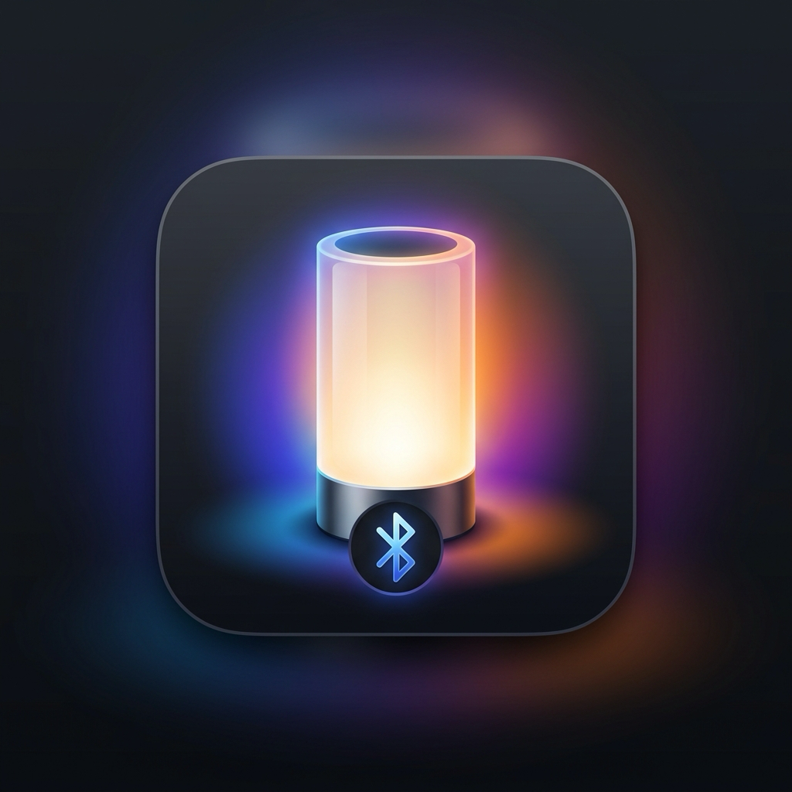

# Zengge / MagicHome BLE Smart Lamp Home Assistant Integration

<p align="center">
  
</p>

<p align="center">
  <a href="https://hacs.xyz"></a>
  <a href="https://home-assistant.io"></a>
  <a href="https://deepmind.google"></a>
  <a href="LICENSE"></a>
</p>

A high-performance, fully reverse-engineered Home Assistant custom integration for **Zengge / MagicHome / Surplife Bluetooth Low Energy (BLE)** smart lamps, ambient table lights, bulbs, and LED controllers utilizing the **HagallBjarkan** (`com.zengge.hagallbjarkan`) transport protocol.

---

## ✨ Features

- **🚀 Real-Time Local Push Telemetry**: Subscribes directly to GATT notifications on `0xFF02`. State changes made via the physical capacitive touch controls or other clients update Home Assistant instantly.
- **🔍 Native Bluetooth Discovery**: Discovers lamps advertising `0xFFFF` service or `IOTBT*` names automatically via Home Assistant's Bluetooth integration.
- **📡 Seamless ESPHome Bluetooth Proxy Support**: Uses Home Assistant's native `bleak-retry-connector` for reliable multi-room roaming, slot negotiation, and proxy roaming across ESP32 Active Proxies.
- **🎨 Complete RGB, 9-Bit HSV & CCT White Control**:
  - Full RGB / HSV Color Wheel (`ColorMode.HS`) supporting both standard (`0xA1`) and 9-bit Hue (`0xC1`) hardware
  - Tunable White / CCT (`ColorMode.COLOR_TEMP`) from **2700K** (Warm White) to **6500K** (Cool White) on RGB+CCT fixtures with independent white brightness scaling ($1\% \dots 100\%$)
  - Automatic hardware profile switching based on `productId` (`0x000E` RGB+CCT vs `0x00C5` RGB-only addressable string lights)
- **🔥 Rich Native Hardware Scenes & Effects**:
  - **RGB+CCT Lamps (`0x000E`)**: 26 reverse-engineered firmware effect sequences (Flame, Breathe, Heartbeat, Three-Color Gradient, Lightning, and more)
  - **Carrier-Wave Addressable String Lights (`0x00C5`)**: **79 native effects** — 5 multi-color string presets, 68 built-in dynamic effects (*Christmas1–3, Candy Cane, Halloween1–3, Fireworks, Meteor Shower*, etc.), and 6 hardware microphone music modes
- **⚡ Home Assistant 2026.11+ Marketplace & Hot-Reload Ready**:
  - Ships local `brand/` icon/logo assets for native Marketplace & Integrations UI rendering (`Home Assistant 2026.3+`), `service_data_uuid` (`0x5A00`/`0x5A02`) discovery matchers, and topological submodule hot-reloading on `Reload`
- **🔒 100% Local & Cloud-Free**: Zero cloud APIs, zero internet dependencies, zero vendor lock-in, and zero accounts required.

---

## 🛠️ Supported Devices & Hardware Reference

### ✅ Tested & Confirmed Fully Compatible

* **[Zengge / HagallBjarkan RGB+CCT Ambient Smart Table Lamp (Amazon ASIN: B0CXXWXGG7)](https://www.amazon.com/dp/B0CXXWXGG7)**
  * *Model Identifier*: `IOTBT537` / `0x000E` (`14`) / `E4:98:BB:69:E5:37`
  * *Hardware*: Capacitive touch-dimming base, dual Warm/Cool White LED array + 5050 RGB diode array, BLE 5.0 microcontroller (`ledVersion=10`).
  * *Verification*: 100% verified on physical hardware across power control, HSV color wheel, CCT tunable white scaling, 26 native dynamic scenes, and bidirectional local push telemetry.
* **Zengge / Surplife Carrier-Wave Addressable RGB Christmas String Lights**
  * *Model Identifier*: `IOTBTD84` / `0x00C5` (`197`) / `08:65:F0:41:DD:84` (`BT.5B.00C5.43.28,V8`, PHY6252 `0x5A5B`)
  * *Hardware*: 25 addressable RGB LEDs (`0x19`), Gen-3 Carrier-Wave Symphony (`wifibleCarrierWaveSymphony` / `hc3`) BLE 5.0 controller (`ledVersion=8`).
  * *Verification*: 100% verified on physical hardware across power control (`E0 01 00 23/24`), 9-bit HSV color control (`E0 01 00 C1`), 5 multi-color string presets (`EC 07`), 68 built-in dynamic effects (`E1 21`), 6 device-mic music modes (`EC 03`), and bidirectional `0xFF02` telemetry (`EA810000C508...`).

### ⏳ Expected Compatible (Community Testing Welcome)

* **Zengge / Surplife BLE 5.0 Smart Bulbs, Downlights & Ceiling Fixtures** (sharing service `0000ffff-0000-1000-8000-00805f9b34fb` and the HagallBjarkan protocol).
* **Zengge / Surplife Gen-3 Carrier-Wave Fairy / String / Symphony Controllers** (`0x5A00` / `0x5A02` advertisement service data and `symphonyE1` / `EC 07` framing).
* **MagicHome / Zj-BLE LED Strips and Controllers** (both modern HagallBjarkan framed and legacy raw-frame revisions).

> [!NOTE]
> These devices share the same underlying HagallBjarkan protocol and command set and are expected to work out-of-the-box. If your device behaves unexpectedly or any features do not work, please [open a GitHub issue](https://github.com/stncttr908/ha-zengge-ble/issues) following the guidelines in the [Reporting Issues](#-troubleshooting--reporting-issues) section below!

---

## 📦 Installation

### Option 1: Home Assistant Marketplace (`2026.11+`) / HACS (Recommended)

1. Open **Settings > Marketplace** (or **HACS > Integrations** on Home Assistant `< 2026.11`).
2. Open the overflow menu (top right) and select **Custom repositories**.
3. Add this repository:
   - **Repository URL**: `https://github.com/stncttr908/ha-zengge-ble`
   - **Category / Type**: `Integration`
4. Click **Add**, search for **"Zengge BLE Smart Light"**, and click **Download / Install**.
5. On **Home Assistant `2026.11+`**, fresh installations load immediately without restarting Home Assistant and open discovery/setup right away. (On Home Assistant `< 2026.11`, restart Home Assistant first.)

### Option 2: Manual Installation

1. Copy the `custom_components/zengge_ble/` directory into your Home Assistant installation under `<config>/custom_components/`:
   ```bash
   <config>/custom_components/zengge_ble/
   ├── __init__.py
   ├── config_flow.py
   ├── const.py
   ├── coordinator.py
   ├── light.py
   ├── manifest.json
   ├── strings.json
   ├── zengge_protocol.py
   ├── brand/
   │   ├── icon.png
   │   ├── icon@2x.png
   │   ├── logo.png
   │   └── logo@2x.png
   └── translations/
       └── en.json
   ```
2. Restart Home Assistant (for `v0.2.0+`, subsequent Python updates to `custom_components/zengge_ble/` can be applied via integration **Reload** without restarting Core).

---

## ⚙️ Configuration & Pairing

### Automatic Discovery
1. Power on your Zengge / Surplife lamp.
2. In Home Assistant, open **Settings** > **Devices & Services**.
3. The discovered lamp will appear automatically with a **"Discovered"** card (e.g. `IOTBT537...`).
4. Click **Configure** and confirm to add the entity.

### Manual Configuration
1. Go to **Settings** > **Devices & Services** > **Add Integration**.
2. Search for **"Zengge BLE Smart Light"**.
3. Select your lamp from the discovered list, or choose **"Manually enter Bluetooth MAC address"** and supply the 6-byte hex address (e.g. `E4:98:BB:69:E5:37`).

---

## 📡 ESPHome Bluetooth Proxy Setup

For whole-home coverage beyond the physical range of your server's onboard Bluetooth, configure any ESP32 with active Bluetooth proxying:

```yaml
esp32_ble_tracker:
  scan_parameters:
    active: true

bluetooth_proxy:
  active: true
```

The integration automatically establishes connections through the nearest ESPHome proxy using `bleak-retry-connector`.

---

## 🌈 Native Hardware Scene Catalog

| Scene Name | Mode ID | Execution Engine | Description |
| :--- | :---: | :--- | :--- |
| **Custom Flame** | `0x2C` | Dynamic Pattern Upload | Realistic 8-step flickering candle / fireplace flame |
| **Preset Breathe** | `0x01` | Color-Aware Pattern | Dynamic 2-step pulsing breath matching active color |
| **Three Color Gradient** | `0x25` | Dynamic Pattern Upload | Tri-color smooth continuous color wash |
| **Five Color Jump** | `0x26` | Dynamic Pattern Upload | Stepped 5-color jumping transition |
| **Colorful Breath** | `0x27` | Dynamic Pattern Upload | Multi-color spectrum breathing cycle |
| **Heartbeat** | `0x28` | Dynamic Pattern Upload | Pulsing rhythmic heartbeat cadence |
| **Lightning** | `0x29` | Dynamic Pattern Upload | Thunderstorm strobe flash effect |
| **Step Change** | `0x02` | Built-in ROM Preset | Crisp color stepping |
| **Rhythm Change** | `0x03` | Built-in ROM Preset | Cadence rhythm shift |
| **Leisure** | `0x04` | Built-in ROM Preset | Relaxing warm ambient tones |
| **Night Light** | `0x05` | Built-in ROM Preset | Ultra-dim amber night light |
| **Good Night** | `0x06` | Built-in ROM Preset | Sunset fade sleep aid lighting |
| **Read** | `0x07` | Built-in ROM Preset | Neutral 4000K high-clarity reading white |
| **Work** | `0x08` | Built-in ROM Preset | Crisp 6500K cool daylight for focus |
| **Grassland** | `0x09` | Built-in ROM Preset | Fresh green palette |
| **Colorful** | `0x0A` | Built-in ROM Preset | Vivid spectrum dynamic cycle |
| **Dazzling** | `0x0B` | Built-in ROM Preset | High-energy dynamic party colors |
| **Gorgeous** | `0x0C` | Built-in ROM Preset | Deep romantic purple & rose blend |
| **Blue Sky** | `0x0D` | Built-in ROM Preset | Azure sky blue |
| **Sunflower** | `0x0E` | Built-in ROM Preset | Golden sunflower yellow |
| **Forest** | `0x0F` | Built-in ROM Preset | Deep evergreen forest tones |
| **Mediterranean** | `0x10` | Built-in ROM Preset | Aquamarine ocean gradient |
| **French Style** | `0x11` | Built-in ROM Preset | Soft pastel romantic colors |
| **American Style** | `0x12` | Built-in ROM Preset | Rich saturated primary tones |
| **Birthday Party** | `0x13` | Built-in ROM Preset | Party festivity loop |
| **Wedding Day** | `0x14` | Built-in ROM Preset | Soft warm romantic glow |

### 🎄 Carrier-Wave String Light Effects (`Product ID 0x00C5` / `IOTBTD84`, 79 Total)

- **Multi-Color String Presets (`EC 07`, 5)**: *Preset Red & Green, Preset Red, White & Blue, Preset Yellow & Red, Preset Purple & Orange, Preset Rainbow*
- **Festival Effects (`E1 21`, 19)**: *Christmas1, Christmas2, Christmas3, Halloween1, Halloween2, Halloween3, Valentine's Day, Children's Day, Easter, Birthday, St.Patrick Day, Pumpkin Festival, Puppet Festival, Easter Eggs, Candy Cane, Carnival, Lemon Festival, Beer Festival, Midsummer Festival*
- **View Effects (`E1 21`, 7)**: *Volcanic Eruption, Starry Night Sky, Thunder And Lightning, Meteor Shower, Fantasy Fireworks, Summer Wind, Moonlight*
- **Atmosphere Effects (`E1 21`, 7)**: *Holiday, Bonfire Party, Neon World, Journey To The Planet, Dynamic Rhythm, Champagne Party, Movie Night*
- **Commerce Effects (`E1 21`, 7)**: *Dynamic Flow Line, Science, Midnight City, Advertising, Fireworks Festival, Rainbow Water, Quality Stroke*
- **Romantic Effects (`E1 21`, 7)**: *Candlelight Dinner, Confession Surprise, Dating, Wedding Vow, Music Box Beats, Rose Petal, Garden Picnic*
- **Life Effects (`E1 21`, 21)**: *Night Lamp, Sunlight, Cozy, Sports, Work, Dinner, Patio, Night View, Cloakroom, Rest, Read, Outdoor Lighting, Childlike, Camping, Meditation, Shadow, Macaron, Coffee Time, C Location, Little Beauty, Star*
- **Hardware Microphone Music Modes (`EC 03`, 6)**: *Music Synchronized Breathing, Music Asynchronous Breathing, Music Gradient, Music Jump, Music Strobe, Music Background Flashing*

---

## 🔬 Reverse Engineered Protocol Specs

* **Primary GATT Service**: `0000ffff-0000-1000-8000-00805f9b34fb` (`0xFFFF`)
* **Advertisement Service Data Discovery**: `0x5A00` / `0x5A02` (`bytes[8:10]` = 16-bit big-endian `productId`, `bytes[10]` = `firmwareVer`, `bytes[11]` = `ledVersion`)
* **Write Characteristic**: `0000ff01-0000-1000-8000-00805f9b34fb` (`0xFF01`)
* **Telemetry Characteristic**: `0000ff02-0000-1000-8000-00805f9b34fb` (`0xFF02`)
* **Transport Framing**: `[Ctrl, Seq, 0x80, 0x00, TotalLen_H, TotalLen_L, StepLen, CmdID=0x0A, ...Payload]`
* **Carrier-Wave (`0x00C5`) Command Extensions**:
  * **Status Query**: `EA 81 8A 8B 59` | **Power ON / OFF**: `E0 01 00 23 ...` / `E0 01 00 24 ...`
  * **9-bit HSV Solid Color (`0xC1`)**: `E0 01 00 C1 [H>>1] [((H&1)<<7)|S] [V] 00 00 00 00 14 00 00`
  * **Multi-Color String Presets (`EC 07`)**: `EC 07 00 [bri] [n_colors] [N × 5B 9-bit HSV00]`
  * **Built-in Effects (`E1 21`)**: `E1 21 00 [bri] [mode] [dir] [step] [param] [speed] 00 [bg 5B] [n] [N × 5B]`
* **Telemetry Notification Format**: JSON-encapsulated hex payload string:
  `{"code":0,"payload":"EA8100000E0A23612810F0786464000000000000000000000000"}`
  * Bytes `3..4`: Big-endian `productId` (`0x000E` = Floor Lamp, `0x00C5` = Carrier-Wave String Lights); Byte `5`: `ledVersion`
  * Byte `6`: Power state (`0x23` = ON, `0x24` = OFF)
  * Byte `7`: Mode flag (`0x61`/`0x70` on `0x000E`; `0x24`=Static/Preset, `0x25`=Effect, `0x62`=Music, `0x66`=Smudge on `0x00C5`)
  * Byte `8`: Sub-mode / active scene identifier
  * Byte `10`: Active channel (`0xF0` = RGB, `0x0F` = White/CCT on `0x000E`; `0x00` on `0x00C5`)
  * Bytes `11–13`: HSV color parameters (`Hue / 2` or 9-bit Hue, Saturation %, Brightness %)
  * Bytes `14–15`: CCT White parameters (Cool White %, White Brightness %) on RGB+CCT fixtures; Byte `18`: Addressable point count (`0x19` = 25 LEDs on `IOTBTD84`)

---

## 📋 Troubleshooting & Reporting Issues

If your device does not connect, shows missing controls, or fails to execute effects, please [open a GitHub issue](https://github.com/stncttr908/ha-zengge-ble/issues) and include the following details so we can add support for your hardware revision:

### 1. Device Information
* **Product Name & Store Link**: Brand, model name, and a link to the store/Amazon listing (even if currently unavailable).
* **Physical Capabilities**: (e.g. RGB only, RGB + Tunable White CCT, Warm White only, Dimmable).
* **Original App**: What mobile app was the device originally paired with (Surplife, Magic Home, Magic Home Pro, Zengge, etc.).

### 2. Bluetooth Identification & Discovery Data
* **Advertised Local Name**: (e.g. `IOTBT537`, `LEDnet_...`, `HB_...`, `Zengge_...`).
* **Device MAC Address / UUID Prefix**: (e.g. `E4:98:BB:...`).
* **Advertised Service UUIDs**: (e.g. `0000ffff-0000-1000-8000-00805f9b34fb`).

### 3. Home Assistant Debug Logs
Enable debug logging for the integration by adding the following to your `configuration.yaml` and restarting Home Assistant (or enabling debug logging via **Settings** > **Devices & Services** > **Zengge BLE Smart Light** > **Enable Debug Logging**):

```yaml
logger:
  default: info
  logs:
    custom_components.zengge_ble: debug
    bleak_retry_connector: debug
```

Reproduce the issue, download the diagnostic log, and attach the relevant `custom_components.zengge_ble` log snippet to your issue.

### 4. Telemetry / Raw Notification Payloads (If Available)
Look for lines in your Home Assistant debug log containing:
* `Inbound GATT notification raw on ... (len=...): ...`
* `Decoded Upper payload on ...: {"code":0,"payload":"EA81..."}`
* `Parsed telemetry status on ...: power=..., mode=..., bri=...`

Sharing these hex payloads allows us to quickly map any new opcode variations, channel flags, or scene IDs for your hardware revision!

---

## 🤖 Autonomous Engineering & Vibe Coding by Gemini

This entire integration, protocol engine, and test harness was **100% vibe coded and reverse-engineered autonomously by Google Gemini** via the **Antigravity** agentic pairing environment without any vendor documentation or proprietary SDKs.

### Reverse Engineering & Development Toolchain

* **🔬 Android HCI BTSnoop & Wireshark Dissection**: Automated ingestion and correlation of raw Android bugreports (`btsnoop_hci.log`) to isolate GATT characteristics, opcode sequences, and the `0x8000` transport framing layer.
* **⚡ Bytecode Analysis (`jadx` / Ghidra)**: Static decompilation of the vendor Android APK to uncover the obfuscated HagallBjarkan protocol classes (`LowerTransportLayerDecoder`, `UpperTransportLayer`, CRC algorithms, and multi-step pattern structures).
* **🧪 In-Situ Hardware Characterization (`Bleak` & CoreBluetooth)**: Live over-the-air fuzzing and protocol validation against physical lamp hardware (`IOTBT537`).
* **🐳 Isolated OrbStack Test Harness (`ha-test`)**: Provisioned an isolated Docker testbed running Home Assistant Core paired with an ESP32 Active Bluetooth Proxy to autonomously validate real-world proxy roaming, MTU negotiation, and zero-mDNS leakage without disturbing production IoT infrastructure.
* **🛡️ 100% Test Coverage & Protocol Invariants**: Standalone regression test suite (57/57 tests passing) verifying packet serialization, 9-bit HSV Carrier-Wave encoding, telemetry reassembly, optimistic state transitions, and `bleak-retry-connector` reliability.

### 🥩 Meat Proxy™ Hardware Operator Credit

Special credit and gratitude to **[@stncttr908](https://github.com/stncttr908)** for serving as the dedicated **Meat Proxy™** throughout this research—faithfully plugging in USB cables, power-cycling power strips, generating Android bugreports, and pressing physical capacitive touch buttons whenever AI agentic autonomy hit the physical barrier of meatspace.

---

## 📝 Changelog

### `v0.2.0` (2026-11-21)
- **New Device Support**: Added full reverse-engineered support for **Zengge / Surplife Carrier-Wave Addressable RGB Christmas String Lights (`IOTBTD84`, Product ID `0x00C5`)** including 9-bit HSV solid colors (`0xC1`), 5 multi-color string presets (`EC 07`), 68 built-in dynamic effects (`E1 21`), 6 device-mic music modes (`EC 03`), silent power-off (`E0 01 00 24`), and `EA810000C508...` telemetry decoding.
- **Auto Hardware Profiling**: Added `0x5A00`/`0x5A02` service data parsing and dynamic `ColorMode` / `effect_list` / `DeviceInfo` adaptation per `productId`.
- **Home Assistant 2026.11+ Marketplace & Hot-Reloading**: Added `issue_tracker` and `service_data_uuid` matchers in `manifest.json`, local `brand/` icon/logo assets (`2026.3+`), and topological submodule hot-reloading in `async_setup_entry`.
- **Fixes**: Fixed missing `import asyncio` in `coordinator.py` and serialized concurrent GATT commands via `_cmd_lock` in `ZenggeLampDevice`.

### `v0.1.0` (2026-09-01)
- Initial release supporting Zengge / HagallBjarkan RGB+CCT smart lamps (`IOTBT537`, Product ID `0x000E`) with local push `0xFF02` telemetry, HSV + CCT tunable white, 26 native hardware scenes, and ESPHome Bluetooth Proxy support.

---

## 📄 License

Distributed under the MIT License. See `LICENSE` for details.
